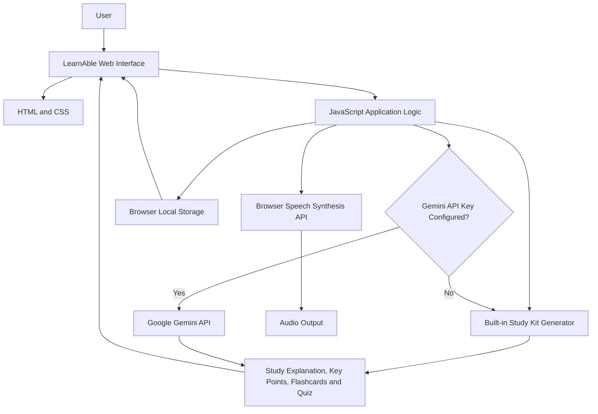

# logicodix

# LearnAble – Accessible AI Learning Hub

## 1. Project Information

- **Team Name:** Print_Owl
- **Team Members:**
  - Member 1 – Syedya Moazma Gardesi
  - Member 2 – Aulia Rameyza
  - Member 3 - Joanna Evangeline Handoko
  - Member 4 - Celvian Ghagatapraja Asifa
- **Category:** Web
- **Application Name:** LearnAble

## 2. Application Overview

**LearnAble** is a web-based learning tool that helps students study using their own notes or lesson materials. Users can paste learning material and generate a study kit containing a simple explanation, key points, flashcards, and quiz questions.

The application also includes accessibility settings, text-to-speech, and a learning-progress tracker. Its goal is to make reviewing lessons more flexible and accessible.

### Problem

Students may find it difficult to understand, organize, and review lesson materials. Some learning tools may also lack display and accessibility options that support different learning preferences.

### Proposed Solution

LearnAble provides several study features in one place. Students can turn their notes into study materials, listen to text, adjust the display, practice with quizzes, and review their progress.

### Target Users

- Students who want to review lessons independently.
- Learners who prefer explanations, flashcards, or quizzes.
- Users who benefit from text-to-speech and adjustable display settings.

## 3. Main Features Implemented

| Feature | Description |
|---|---|
| Study Material Input | Users can enter a topic and paste their notes or lesson material. |
| Study Kit Generator | Creates a simple explanation, key points, flashcards, and quiz questions from the submitted material. |
| AI Study Buddy | Provides a question-and-answer area for questions about the learning material. Gemini API support is optional. |
| Adaptive Quiz Coach | Provides multiple-choice questions and adjusts the difficulty level based on the user's answers. |
| Text-to-Speech | Reads the submitted material, explanation, and quiz questions aloud using the browser's Speech Synthesis API. |
| Accessibility Settings | Includes high contrast, a dyslexia-friendly font option, reduced motion, and adjustable text size. |
| Learning Progress | Tracks answered questions, accuracy, day streak, and topic practice. |
| Local Data Storage | Saves accessibility preferences and learning progress in the browser's local storage. |

## 4. Technologies Used

| Technology / Service | Purpose |
|---|---|
| HTML5 | Defines the structure and content of the application. |
| CSS3 | Handles the layout, styling, responsive design, and accessibility-related display options. |
| JavaScript | Implements the application's features and interactions. |
| Browser Local Storage | Stores accessibility preferences and learning progress locally. |
| Web Speech API (Speech Synthesis) | Reads text aloud in supported browsers. |
| Google Gemini API (optional) | Generates study-kit content and answers questions when an API key is configured. |

**Frameworks and libraries:** The current implementation uses plain HTML, CSS, and JavaScript. No external framework or JavaScript library is required.

**Database:** No external database is used. Progress and accessibility preferences are stored in the user's browser.

**Third-party services:** Google Gemini API is an optional service. Without a configured API key, the application uses its built-in study-kit generator and fallback answer behavior.

## 5. System Architecture and Data Flow

### Architecture Diagram



### Data Flow

1. The user opens LearnAble in a web browser.
2. The user enters a topic and pastes learning material.
3. JavaScript processes the material using the built-in generator.
4. If a Gemini API key is configured, the application can also request generated content from the Gemini API.
5. The study explanation, key points, flashcards, and quiz are displayed on the page.
6. The user can practice quiz questions and receive feedback.
7. Quiz results are saved in browser local storage and used to update the progress section.
8. Accessibility preferences are also saved locally.
9. When the user selects a listening option, the browser's Speech Synthesis API reads the selected text aloud.

## 6. Installation and Setup

### Requirements

- A modern web browser, such as Google Chrome, Microsoft Edge, or Firefox.
- The `index.html` project file.
- An internet connection only if you want to use the optional Gemini API feature.

### Installation Steps

1. Download or clone the project files.
2. Make sure `index.html` is available in the project folder.
3. Open `index.html` in a supported web browser.
4. The LearnAble home page should appear.
5. Enter a topic and paste learning material to generate a study kit.

No package installation or build command is required for the current version.

### Optional Gemini API Configuration

The application can use the Google Gemini API for AI-generated study content and answers.

1. Obtain an API key through Google AI Studio.
2. Open `index.html` in a code editor.
3. Find the following line in the JavaScript section:

   ```javascript
   const GEMINI_KEY = "";
   ```

4. Add your API key locally:

   ```javascript
   const GEMINI_KEY = "YOUR_GEMINI_API_KEY";
   ```

5. Save the file and reopen or refresh the application.

**Important security note:** The current application runs entirely in the browser. A key placed in client-side JavaScript can be viewed by other people who access the application. Use this setup only for local testing with an appropriately restricted key. Do not publish or commit a real API key. A production version should call the AI service through a secure backend instead.

If no API key is configured, LearnAble uses its built-in generator and fallback response behavior. The rest of the application can still be used.

## 7. Configuration and Environment Variables

The current project does not use a `.env` file or environment variables because it is a static browser application.

| Setting | Description |
|---|---|
| `GEMINI_KEY` | Optional Gemini API key configured in the JavaScript file for local testing. Leave it empty to use the built-in generator. |

There is no separate database configuration, server configuration, or account configuration in the current implementation.

## 8. Demo Account

LearnAble does not currently include user registration, login, or authentication. Therefore, no demo username or password is required. Open the application directly in a browser to try its features.

## 9. AI Usage Documentation

AI integration is optional in the current version.

- **AI service:** Google Gemini API.
- **Model endpoint used in the source code:** `gemini-1.5-flash`.
- **Purpose:** Generate a study explanation, key points, flashcards, quiz questions, and answers to user questions.
- **User input:** The topic, learning material, and question entered by the user.
- **Fallback behavior:** When the API key is missing or the API request fails, the application uses its built-in JavaScript logic for study-kit generation and a basic fallback response for questions.

The built-in generator extracts sentences and frequently used keywords from the submitted material. Its output is a simple study aid and may not explain every concept accurately. Users should compare generated material with their original notes.

## 10. Third-Party Asset and Code Attribution

The current `index.html` implementation does not include external image assets, downloaded templates, external datasets, or third-party JavaScript libraries.

The project uses browser-provided features, including:

- **Web Speech API (Speech Synthesis):** Browser functionality used for text-to-speech.
- **Google Gemini API:** Optional external AI service, if configured.

If third-party assets, datasets, templates, or code are added in a future version, their original sources and licenses should be documented here.

## 11. Limitations

- The current version does not have user accounts or cloud synchronization.
- Learning progress and accessibility settings are stored only in the browser where the application is used.
- The built-in generator uses basic sentence and keyword extraction; it is not a replacement for a full AI model.
- Gemini API access depends on a valid API key, network access, and the availability and terms of the external service.
- Speech synthesis availability and voice quality depend on the user's browser and device.
- The current client-side API-key configuration is intended for local testing, not public production deployment.

## 12. Project Structure

```text
LearnAble/
├── index.html
└── README.md
```

The HTML file contains the application's HTML structure, CSS styling, and JavaScript functionality.

---

## 13. Frontend Documentation

**Framework and technology.** The frontend is built with plain HTML, CSS and JavaScript (vanilla JS), with no framework and no build step. The whole app lives in one file, `public/index.html`, so it can be opened directly and served by the Node.js server.

| Component | Technology | Purpose |
|---|---|---|
| Interface | Semantic HTML5 + CSS (theme variables) | Pages, responsive layout, display themes |
| Logic | JavaScript (ES2020) | Builds study kits, quizzes, cards, practice games and chat |
| Fonts | Google Fonts: Press Start 2P, Space Grotesk | Pixel-art style and readable text |
| Sign-in and saved notes (optional) | `@supabase/supabase-js@2` via jsDelivr CDN | Authentication and storage in Supabase |
| Local storage | `localStorage` | Theme, progress (XP, streak) and notes on the device |
| Configuration | `public/config.js` | API address and public Supabase key (no secrets) |

**UI component structure** (all in `public/index.html`):

| Element | Role |
|---|---|
| `main#main` | Main study area: topic and notes input, summary, key points |
| `aside#displayPanel` | Display and accessibility settings panel |
| `section#cards` | Flashcards and practice |
| Quiz and practice games | Multiple-choice quiz with explanations, memory game and letter-scramble game |
| Poppy (chat) | AI study buddy, available from the chat panel |
| `dialog#welcomeDialog` | First-visit welcome |
| `dialog#authDialog` | Sign in / sign up (when Supabase is configured) |
| `dialog#setupDialog` | Setup guide |

**Frontend flow.** The user pastes notes, and the frontend calls `POST /api/study-kit`. If the server or the AI is unavailable, the frontend automatically uses the built-in study-kit generator in the browser, so the app keeps working. Questions to Poppy go through `POST /api/chat` in the same way.

**Assets.** There are no external image files. The site icon is an inline SVG, the pixel-art style characters and visuals are made with CSS/HTML, and fonts are loaded from Google Fonts.

---

## 14.Backend Documentation

**Technology.** Node.js 20+ with no extra dependencies (only the built-in `http`, `fs` and `path` modules). AI uses the Google Gemini API (model `gemini-2.5-flash`, changeable with `GEMINI_MODEL`). The API key exists only on the server and is never sent to the browser.

File structure:

```
server.js          HTTP server, routing, rate limit, CORS, static file serving
lib/env.js         .env file reader
lib/gemini.js      Gemini API client (key sent in a header, not the URL)
lib/study.js       AI prompts, result validation and normalization
tests/api.test.js  11 automated tests (use a fake Gemini)
public/            Frontend (index.html, config.js)
```

### API Endpoints

| Method | Endpoint | Body | Success response |
|---|---|---|---|
| `POST` | `/api/study-kit` | `{ "topic": string, "notes": string }` | `200` `{ summary, points[], cards[{front,back,term}], quiz[{question,options[4],answer,explanation}], terms[] }` |
| `POST` | `/api/chat` | `{ "message": string, "topic": string, "notes": string }` | `200` `{ "reply": string }` |
| `GET` | `/api/health` | none | `200` `{ "ok": true, "ai": true/false }` |

Error codes: `400` invalid input (empty topic, notes shorter than 30 characters, broken JSON), `413` request body too large (max 32 KB), `429` too many requests (max 30 per minute per IP), `502` AI service failed or its result was unusable, `503` AI key not configured. For `502` and `503` the frontend automatically switches to the built-in generator.

Safeguards: input validation and length limits, per-IP rate limiting, AI output is rebuilt and validated before reaching the user (every question must have 4 unique options and an answer that is one of them), user notes are treated as data and not as instructions to reduce prompt injection, and request contents are not logged or stored.

### Database Schema (optional, Supabase)

The database is only used for sign-in and saving notes. Without Supabase, data is kept in the device's `localStorage`. Run this SQL in the Supabase SQL Editor:

```sql
create table if not exists study_sets (
  id uuid primary key default gen_random_uuid(),
  user_id uuid not null references auth.users(id) on delete cascade,
  topic text not null,
  material text,
  summary text,
  points jsonb,
  cards jsonb,
  quiz jsonb,
  updated_at timestamptz default now(),
  unique (user_id, topic)
);
create table if not exists user_progress (
  user_id uuid primary key references auth.users(id) on delete cascade,
  xp int default 0,
  answered int default 0,
  correct int default 0,
  streak int default 0,
  last_day text,
  topics jsonb default '{}',
  mission jsonb default '{}',
  updated_at timestamptz default now()
);
alter table study_sets enable row level security;
alter table user_progress enable row level security;
create policy "own sets" on study_sets for all using (auth.uid() = user_id) with check (auth.uid() = user_id);
create policy "own progress" on user_progress for all using (auth.uid() = user_id) with check (auth.uid() = user_id);
```

Row Level Security is enabled, so each user can only read and change their own data.

### .env.example

```env
# Copy to .env and fill in. Never commit .env.
# Free key: https://aistudio.google.com/apikey
GEMINI_API_KEY=
GEMINI_MODEL=gemini-2.5-flash
PORT=3000
# Only needed if the frontend is hosted at a different address than this server (comma-separated)
ALLOWED_ORIGIN=
# Set to 1 behind a reverse proxy (Render, Railway, Fly) so rate limiting sees the real IP
TRUST_PROXY=0
```

---

## 15. Localhost Instructions

**Requirements:** Node.js version 20 or newer (download at https://nodejs.org), Git, and a free Gemini API key from https://aistudio.google.com/apikey. There is no `npm install` step because the project has no external dependencies.

1. **Download the project**
   ```bash
   git clone YOUR_REPOSITORY_URL
   cd YOUR_REPOSITORY_FOLDER
   ```
2. **Check the Node.js version** (must be 20 or higher)
   ```bash
   node --version
   ```
3. **Create the `.env` file**
   - macOS / Linux: `cp .env.example .env`
   - Windows (Command Prompt): `copy .env.example .env`

   Open `.env` and put your key after `GEMINI_API_KEY=`.
4. **Start the app**
   ```bash
   npm start
   ```
   The terminal shows: `LearnAble running on http://localhost:3000 (AI on)`.
5. **Open it in the browser:** http://localhost:3000
6. **Try the AI features:** click the demo button to build a study kit, then ask Poppy a question. Check the server status at http://localhost:3000/api/health (it should show `"ai":true`).
7. **Run the automated tests** (no real key needed)
   ```bash
   npm test
   ```

**Troubleshooting:**

| Symptom | Cause and fix |
|---|---|
| `AI off: set GEMINI_API_KEY` | The key is not set in `.env`. Fill it in, then run `npm start` again. |
| `Port 3000 already in use` | Set `PORT=3001` in `.env`, then open http://localhost:3001. |
| `node` not recognized | Node.js is not installed, or the terminal needs to be reopened. |
| Study kit stays basic | The server or AI failed and the app used its built-in generator. Check the terminal and `/api/health`. |

(Optional) For sign-in and saved notes, create a Supabase project, run the SQL from the Database Schema section, then fill in `supabaseUrl` and `supabaseAnonKey` in `public/config.js`.

**LearnAble – Learn in the way that works for you.**
